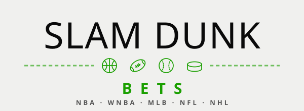
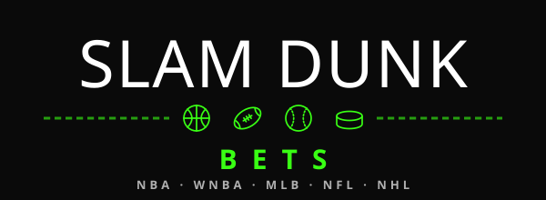

<!-- Paid-traffic landing page (X ads and other campaigns). Kept out of search with noindex and out of
     sitemap.xml by _scripts/post-render.sh; not in the navbar or llms.txt. Numbers must match the FAQ. -->

:::: hero
::: hero-banner
{.banner-light fig-alt="Slam Dunk Bets"} {.banner-dark fig-alt="Slam Dunk Bets"}
:::

# Prop picks backed by 8,000+ units of tracked ROI. First month free.

::: hero-lede
Our models price first baskets, touchdown scorers and goal scorers for every NBA, NFL and NHL game, check them against the books every 30 minutes, and post the edges to Discord with unit sizes.
:::

[Start your free month](https://sharpduel.com/slam_dunk_bets){.btn .btn-primary .btn-lg role="button"}

::: lp-fineprint
30 days free, then from $19.99 a week. Cancel anytime. 21+.
:::
::::

:::::: lp-stats
::: lp-stat
**8,000+**

net units since 2021–22
:::

::: lp-stat
**+2,135**

units in the 2025–26 NBA season, 16.3% ROI
:::

::: lp-stat
**Every bet**

graded and tracked, receipts daily
:::
::::::

::: track-record
## The record, every pick since 2021–22

.](images/home/cumulative_total.png){fig-alt="Line chart of cumulative net units for Slam Dunk Bets picks from October 2021 to October 2026, climbing from 0 to about 8,600 units"}
:::

::: feature-list
## What you get

- **Picks in Discord** with unit sizes, refreshed every 30 minutes as lines move
- **NBA first baskets**, team to score first, first assist, rebound and three; **NFL** anytime and first touchdown; **NHL** first and anytime goal; WNBA and MLB in season
- **Daily ROI receipts** for every market, wins and losses
- **The Slam Dunk Dashboard**: every edge, every book's price, and the full graded record
:::

::: hall-of-fame
## Real green tickets

```{=html}
<div class="hof-carousel-wrap">
  <div id="hofCarousel" class="carousel slide carousel-fade" data-bs-ride="carousel" data-bs-interval="3200" data-hof-manifest="images/hof-carousel/manifest.json" data-hof-image-base="images/hof-carousel/">
    <div class="carousel-inner">
      <div class="hof-loading" role="status" aria-label="Loading Hall of Fame receipts"></div>
    </div>
    <button class="carousel-control-prev" type="button" data-bs-target="#hofCarousel" data-bs-slide="prev" aria-label="Previous receipt">
      <span class="carousel-control-prev-icon" aria-hidden="true"></span>
    </button>
    <button class="carousel-control-next" type="button" data-bs-target="#hofCarousel" data-bs-slide="next" aria-label="Next receipt">
      <span class="carousel-control-next-icon" aria-hidden="true"></span>
    </button>
  </div>
</div>
<script src="scripts/hof-carousel.js"></script>
```
:::

::: lp-pricing
## Pricing

::: {.pricing}
| Plan | Price | Free trial |
|---|---|---|
| Weekly | $19.99 / week | 30 days |
| Monthly | $49.99 / month | 30 days |
| Annual | $499.99 / year | 30 days |
:::

Sharpduel runs a $1 card check at signup. Cancel anytime from your Sharpduel account.
:::

::: lp-faq
::: {.faq-item}
### Do you take bets?

No. We're a picks and data service, not a sportsbook. You place your own bets wherever you play, and only where sports betting is legal for you.
:::

::: {.faq-item}
### What happens after the free month?

Your plan renews at the price you picked unless you cancel before the 30 days are up. Cancel from Sharpduel in a couple of taps.
:::

::: {.faq-item}
### Are the results real?

Every pick is logged and graded, wins and losses, with daily receipts in Discord and the full record in the Dashboard. More in the [FAQ](faq.qmd).
:::
:::

::: final-cta
## Ready to cash in?

[Start your free month](https://sharpduel.com/slam_dunk_bets){.btn .btn-primary .btn-lg role="button"}

Past results don't guarantee future results. 21+ only. If you or someone you know has a gambling problem, call [1-800-GAMBLER](tel:+18004262537){.text-nowrap}.
:::

```{=html}
<div class="sticky-cta" aria-hidden="true">
  <a class="btn btn-primary" href="https://sharpduel.com/slam_dunk_bets" tabindex="-1">Start your free month</a>
</div>
<script>
  // Show the bottom bar only while neither in-page CTA is on screen.
  (() => {
    const bar = document.querySelector(".sticky-cta");
    const targets = document.querySelectorAll(".hero .btn-primary, .final-cta .btn-primary");
    if (!bar || !targets.length || !("IntersectionObserver" in window)) return;
    const visible = new Set();
    const observer = new IntersectionObserver((entries) => {
      entries.forEach((e) => (e.isIntersecting ? visible.add(e.target) : visible.delete(e.target)));
      bar.classList.toggle("is-shown", visible.size === 0);
    });
    targets.forEach((t) => observer.observe(t));
  })();
</script>
```
