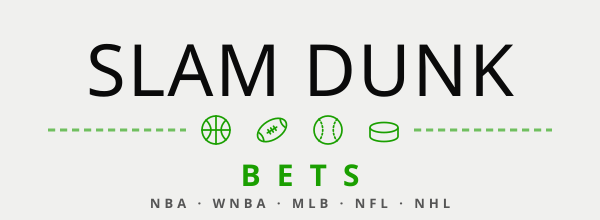
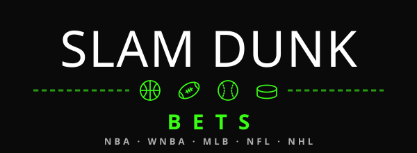
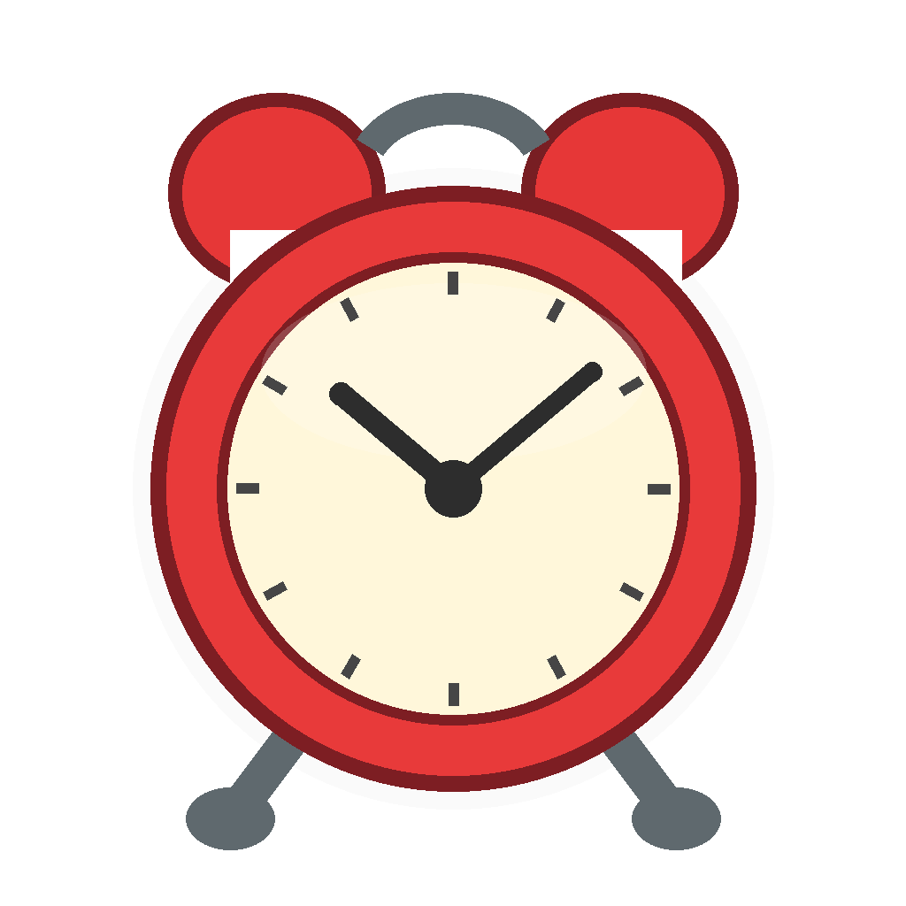

:::: hero
::: hero-banner
{.banner-light fig-alt="Slam Dunk Bets"} {.banner-dark fig-alt="Slam Dunk Bets"}
:::

# Machine-learning projections and picks for NBA, WNBA, MLB, NFL & NHL player props.

::: hero-lede
Slam Dunk Bets is a subscription picks service run by data scientists and engineers. Our machine learning models project first-basket props for every NBA and WNBA game, home runs and NRFI/YRFI for every MLB game, and touchdown and goal scorers for every NFL and NHL game, compare them to sportsbook prices every 30 minutes, and post the edges to Discord with unit sizes. Every bet is tracked and graded in public.
:::

------------------------------------------------------------------------

[Subscribe — Free First Month](https://whop.com/slam-dunk-bets){.btn .btn-primary .btn-lg role="button"}

::: lp-fineprint
Free first month, then \$19.99/week, \$49.99/month or \$499.99/year. Cancel anytime.

21+ only. Gambling problem? Call [1-800-GAMBLER](tel:+18004262537){.text-nowrap}.
:::
::::

::: feature-list
## What you get 🧐

- **Best-in-class projections** for every NBA, WNBA, MLB, NFL & NHL game — first baskets, home runs, touchdown and goal scorers, and more
- **NBA, WNBA, MLB, NFL & NHL prop data and picks** across a growing list of markets
- **Automatic updates every 30 minutes** — projections refresh all day
- **Discord access** with daily ROI receipts, tracked since the 2021–22 NBA season
- **Dashboards & data** to dive deeper for more edges and plays

Browse the picks by sport: [NBA](nba/index.qmd) · [WNBA](wnba/index.qmd) · [MLB](mlb/index.qmd) · [NFL](nfl/index.qmd) · [NHL](nhl/index.qmd)
:::

::::::: how-it-works
## How it works 🛠️

:::::: steps
::: step
{.model-image fig-alt="Robot"}

### 1. Model the slate

------------------------------------------------------------------------

Projections for every NBA, WNBA, MLB, NFL, and NHL game, built from the same stat foundation we've used since 2022.
:::

::: step
{.clock-image fig-alt="Alarm clock"}

### 2. Refresh every 30 minutes

------------------------------------------------------------------------

Picks update automatically as lines move — no stale numbers, no guesswork.
:::

::: step
{.discord-image fig-alt="Check mark"}

### 3. Post picks in Discord

------------------------------------------------------------------------

Daily picks and ROI receipts, straight to your phone through the Discord community.
:::
::::::
:::::::

::: track-record
## Every pick tracked since 2021–22

We've logged and graded every pick since the 2021–22 NBA season, wins and losses. Season-by-season numbers are in the [FAQ](faq.qmd). Past results don't guarantee future results.

 for every season.](images/home/cumulative_total.png){fig-alt="Line chart of cumulative net units for Slam Dunk Bets picks from October 2021 to October 2026, climbing from 0 to about 8,600 units"}
:::

::: hall-of-fame
## Hall of Fame 🏆

Real green tickets from our users, updated daily on Discord.

```{=html}
<div class="hof-carousel-wrap">
  <div id="hofCarousel" class="carousel slide carousel-fade" data-bs-ride="carousel" data-bs-interval="3200" data-hof-manifest="images/hof-carousel/manifest.json" data-hof-image-base="images/hof-carousel/">
    <div class="carousel-inner">
      <div class="hof-loading" role="status" aria-label="Loading Hall of Fame receipts"></div>
    </div>
    <button class="carousel-control-prev" type="button" data-bs-target="#hofCarousel" data-bs-slide="prev" aria-label="Previous receipt">
      <span class="carousel-control-prev-icon" aria-hidden="true"></span>
    </button>
    <button class="carousel-control-next" type="button" data-bs-target="#hofCarousel" data-bs-slide="next" aria-label="Next receipt">
      <span class="carousel-control-next-icon" aria-hidden="true"></span>
    </button>
  </div>
</div>
<script src="scripts/hof-carousel.js"></script>
```
:::

::: final-cta
## Try it free for a month

[Subscribe — Free First Month](https://whop.com/slam-dunk-bets){.btn .btn-primary .btn-lg role="button"}

Free first month, then \$19.99/week, \$49.99/month or \$499.99/year. Cancel anytime. 21+ only.

[Still have questions? See the FAQ](faq.qmd)
:::
