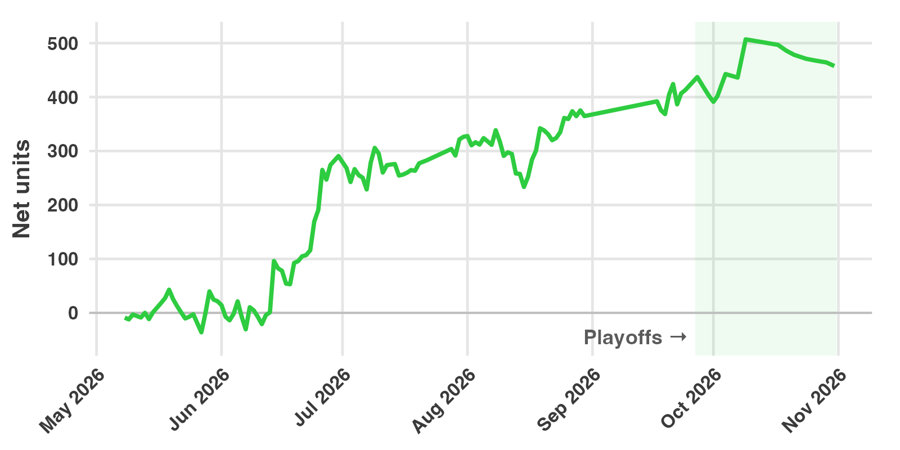

## Summary

Slam Dunk Bets recommended 6,707 wagers on WNBA first-event props in 2026, from opening night on May 8 through Game 7 of the Finals on October 31. The wagers returned +458 net units on 3,728 units staked, a return on investment (ROI) of 12.3%.

This recap was first published on October 6, with the playoffs in progress, and updated on November 1 with the final results through Game 7 of the Finals.

The ROI was lower than in our two previous WNBA seasons. The 2025 season returned +529 units (17.0%). The 2024 season returned +418 units (21.6%).

{fig-alt="Line chart of cumulative net units for the 2026 WNBA season. The line moves around zero through mid-June, rises to about 290 by the end of June, climbs slowly to about 390 by late September, peaks near 507 on October 9, and ends near 458 on October 31."}

## Results by part of the season

| | Wagers | Plays | Wins | Units staked | Net units | ROI |
|---|---:|---:|---:|---:|---:|---:|
| Regular season | 6,341 | 3,807 | 937 | 3,499 | +413 | 11.8% |
| Playoffs | 377 | 249 | 42 | 229 | +45 | 19.5% |
| **Total** | 6,718 | 4,056 | 979 | 3,728 | +458 | 12.3% |

Our last regular-season wagers were on September 24, and our first playoff wagers were on September 27. No games were played between August 31 and September 16, so there were no wagers in that period. It appears as a straight segment in the chart.

14.6% of wagers won. A low win rate is expected for these markets: the median price we bet was +800, which a sportsbook prices as about an 11% chance.

## Results by market

| Market | Wagers | Plays | Wins | Units staked | Net units | ROI |
|---|---:|---:|---:|---:|---:|---:|
| First Basket by Team | 2,662 | 1,409 | 458 | 1,259 | +308 | 24.4% |
| First Basket | 2,063 | 1,038 | 171 | 979 | +186 | 19.0% |
| First Team | 358 | 195 | 187 | 218 | +23 | 10.5% |
| First Three by Team | 346 | 323 | 41 | 293 | +21 | 7.0% |
| First Basket Type | 83 | 65 | 28 | 82 | 0 | -0.1% |
| First Team Exact | 36 | 28 | 12 | 22 | -6 | -26.6% |
| First Basket by Team Exact | 967 | 845 | 77 | 715 | -13 | -1.8% |
| First Basket Exact | 203 | 153 | 5 | 161 | -61 | -38.1% |

The two largest markets produced almost all of the profit. First Basket by Team returned +308 units (24.4%), and First Basket returned +186 units (19.0%). Together that is +494 units, more than the season's entire net.

The exact-method markets did not work this season. In these markets you pick both the scorer and how they score. First Basket Exact lost 61 units, with 5 wins in 203 wagers. First Basket by Team Exact lost 13 units. This differs from our NBA results, where the exact-method markets were among the most profitable ([2025-26 NBA recap](nba-2025-26-recap.qmd)). The WNBA samples are much smaller, and it is not yet clear whether the difference is real.

What the markets mean:

- **First Basket**: the player who scores the game's first points. Some books count only field goals.
- **First Basket by Team**: the first player on a given team to score.
- **Exact** markets: the same selection, plus how the player scores, for example a two-pointer or a layup.
- **First Basket Type**: how the game's first points are scored, regardless of player.
- **First Three by Team**: the first player on a team to make a three-pointer.
- **First Team**: the team that scores first. **First Team Exact** adds how they score.

## Results by month

| Month | Units staked | Net units | ROI |
|---|---:|---:|---:|
| May 2026 | 434 | +22 | 5.0% |
| June 2026 | 988 | +269 | 27.2% |
| July 2026 | 761 | +36 | 4.7% |
| August 2026 | 972 | +38 | 3.9% |
| September 2026 | 427 | +36 | 8.5% |
| October 2026 | 146 | +56 | 38.5% |

Every month was profitable, but June accounted for 59% of the season's net units. From July through September, ROI was between 4% and 9%.

The season's largest decline was 105 units, from +339 on August 8 to +233 on August 15. The total recovered to a new high on August 19. The total peaked at +507 units after the October 9 playoff game and gave back 49 units over the Finals.

We placed wagers on 127 days, and 63 of those days (49.6%) finished positive. The best day was June 14, at +95 units. The worst was September 22, at -38 units.

## Players

These totals combine every market for each player.

| Player | Wagers | Wins | Units staked | Net units | ROI |
|---|---:|---:|---:|---:|---:|
| Diamond Miller | 153 | 19 | 76 | +102 | 133.8% |
| Cecilia Zandalasini | 101 | 24 | 83 | +102 | 122.7% |
| Angela Dugalic | 15 | 11 | 14 | +82 | 577.7% |
| Chelsea Gray | 146 | 31 | 67 | +84 | 125.4% |
| Kalani Brown | 2 | 2 | 7 | +81 | 1203.2% |

The three least profitable players were Natasha Howard (-63 units on 98 wagers, 5 wins), Ariel Atkins (-48 units on 140 wagers, 5 wins), and Isabelle Harrison (-44 units on 92 wagers, 6 wins). In total we placed wagers on 139 players.

Angela Dugalic's total comes almost entirely from one game, on June 14. She scored the game's first basket on a layup, which won wagers in four markets for +80 units. Kalani Brown's comes from one playoff game, on October 9, when she scored the first basket at +1600 and won wagers in two markets for +80 units.

## Largest wins

| Date | Game | Market | Selection | Price | Units staked | Net units |
|---|---|---|---|---:|---:|---:|
| Oct 9, 2026 | GSV @ LVA | First Basket | Kalani Brown | +1600 | 3.6 | +57.1 |
| Aug 25, 2026 | PDX @ DAL | First Basket Exact | Awak Kuier, three-pointer | +5000 | 0.8 | +39.9 |
| Jun 8, 2026 | NYL @ CON | First Basket | Diamond Miller | +1800 | 2.0 | +36.6 |
| Sep 24, 2026 | GSV @ LAS | First Three by Team | Kiah Stokes | +1600 | 2.1 | +33.6 |
| Jun 5, 2026 | CON @ CHI | First Basket by Team Exact | Diamond Miller, two-pointer | +1300 | 2.3 | +30.4 |

: Largest single-play wins

The ten largest wins together returned +330 units, 72% of the season's net. Without them, the season would have returned about +127 units. Most of the profit in these markets comes from a small number of long-odds wins. This season depended on them more than our NBA season did, where the ten largest wins made up 22% of the net. The largest loss on any single play was 3.8 units.

## How accurate were the projections?

For each of the 4,056 plays, we compared our projected probability with the sportsbook's price at the time of the first alert.

| | Expected wins |
|---|---:|
| Our projections | 615 |
| Sportsbook prices | 526 |
| **Actual wins** | **568** |

The plays won 42 more times than the sportsbook prices implied. That gap is the edge the profit comes from. Our projections were too high by 47 wins.

Some of that overestimate is expected. We only bet when our number is higher than the book's, so we mostly act on the cases where our projection is highest. Some of those projections are too high by chance, and that pushes the total up.

## How we counted

- **Wagers and plays.** A play is one recommendation: a player or team, in one market, in one game. When a price improves after the first alert, we recommend adding to the play, and each addition is logged as a separate wager. The same play at a different sportsbook is also a separate wager.
- **Units.** Wager sizes are standardized so that the average recommended wager is about one unit. Net units are winnings minus losses. ROI is net units divided by units staked.
- **Voided wagers.** 430 wagers were voided by the sportsbook, for example when a player did not play. They are excluded from every figure above.
- **Completeness.** The figures include every other wager we alerted from May 8 through October 31, at the price posted when we alerted it. Prediction exchanges are not included.
- **Sportsbooks.** FanDuel accounted for 45% of units staked, at a 15.6% ROI. DraftKings accounted for 42%, at a -1.7% ROI. The rest was spread across Fanatics, BetMGM, theScore, BetRivers, Hard Rock and Caesars.

These are tracked results, not a guarantee. Your results depend on which sportsbooks you can use, how quickly you place a wager after an alert, and any betting limits on your account. Past results do not predict future results.

The live record for every market is in the [Slam Dunk Dashboard](../../apps.qmd), results for every season are in the [FAQ](../../faq.qmd), and the market-by-market record is on our [WNBA picks](../../wnba/index.qmd) pages. How the first-basket models work is covered in our [five-part series](../2024-10/predict-first-baskets-1.qmd). To get the alerts as they post, [subscribe](https://sharpduel.com/slam_dunk_bets).
